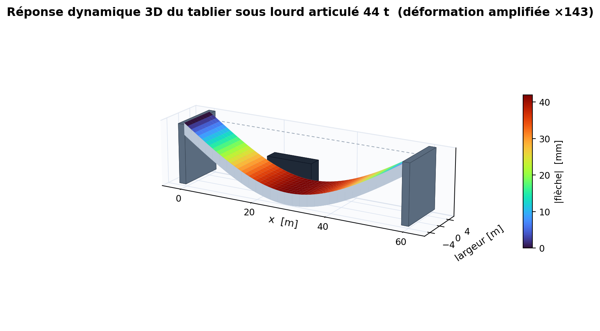
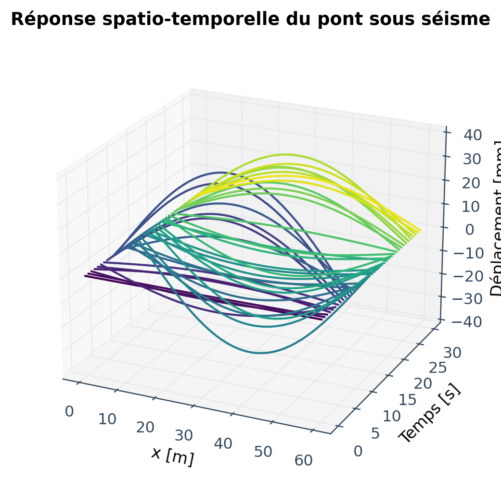

# Bridge Vibration Simulation

Finite-element-based vibration simulation of beam-type bridges.

<p align="center">
  
  
</p>

The package solves the equation of motion

  M · ü(t) + C · u̇(t) + K · u(t) = F(t)

with Euler-Bernoulli beam elements, Rayleigh proportional damping and
constant-average-acceleration Newmark-β time integration.

## Features

### Bridge model
- 2-node Euler-Bernoulli beam elements (consistent mass)
- Materials: structural steel S355, reinforced concrete C30/37, prestressed
  concrete C40/50 (or fully custom)
- Cross-sections: rectangular, single-cell box girder, or custom (A, I)
- Boundary conditions: simply supported, cantilever, multi-span continuous,
  free-free

### Loadings
- **Single moving vehicle** — passenger car, van, bus, rigid truck, 44-t
  articulated lorry (or custom)
- **Mixed traffic stream** — arbitrary mix of vehicles with staggered entries
- **Earthquake** — synthetic Kanai-Tajimi ground motion, configurable PGA,
  dominant frequency, ground damping and duration; applied as `-M·r·a_g(t)`
- **Wind buffeting** — turbulent distributed load with mean wind speed,
  turbulence intensity, drag/lift coefficients
- **Pedestrian crowd** — N pedestrians walking at near-synchronised
  frequencies (Millennium-bridge–type)
- **Harmonic excitation** — fixed-frequency sinusoid for resonance scans
- **Impulse** — half-sine impact (hammer / vehicle drop test)
- **Combined loadings** — sum any of the above

### Analyses
- Modal analysis — mass-normalised mode shapes and natural frequencies
- Newmark-β time-history integration (γ=1/2, β=1/4, unconditionally stable)
- Modal-superposition Frequency Response Function (FRF)
- Damage detection — local stiffness reduction and frequency tracking

### Post-processing
- Mode-shape plots, schematic with mode overlay
- Time-history, FFT amplitude spectrum, FRF magnitude/phase
- Min/max deflection envelopes
- 3-D spatio-temporal waterfall
- GIF animation of the deflected bridge

### Interactive viewer
- Live Matplotlib window with animated deflected bridge and scrolling
  mid-span time history
- One-click switching between six scenarios (truck, earthquake, wind,
  pedestrians, traffic, combined)
- Play / Pause / Restart / speed controls
- Side panel showing scenario description, natural frequencies and peak
  response in mm

## Layout

```
bridge_vibration_sim/
├── bridge_sim/
│   ├── model.py     — FEM assembly, materials, sections, BCs
│   ├── loads.py     — vehicles, earthquake, wind, pedestrians, harmonics
│   ├── solver.py    — modal analysis, Newmark-β, FRF
│   ├── damping.py   — Rayleigh coefficients
│   ├── damage.py    — damage scenarios and frequency sweeps
│   └── post.py      — plotting and animation utilities
├── examples/
│   ├── 01_modal_analysis.py
│   ├── 02_truck_crossing.py
│   ├── 03_earthquake.py
│   ├── 04_pedestrian_resonance.py
│   ├── 05_damage_detection.py
│   ├── 06_wind_buffeting.py
│   ├── 07_traffic_simulation.py
│   ├── 08_combined_scenario.py
│   └── visual_simulation.py    — interactive viewer (run this!)
├── environment.yml             — Anaconda environment spec (includes pygame & ursina)
├── requirements.txt            — pip dependencies
├── notebook.ipynb              — guided Jupyter walkthrough + viewer
├── bridge_simulator_3d.py     — 3D simulator (Ursina/Panda3D) — recommended
├── bridge_simulator.py         — 2D pygame simulator (faster startup)
├── generate_all_figures.py    — produces every figure used in the report
└── figures/                   — output directory
```

## Quick start

### Option A — Anaconda (recommended)

Open **Anaconda Prompt** (Windows) or a terminal with conda active (macOS/Linux), then:

```bash
# 1. Move into the project folder (adjust path to wherever you unzipped it)
cd bridge_vibration_sim

# 2. Create the environment from environment.yml
conda env create -f environment.yml

# 3. Activate it
conda activate bridge-sim

# 4. Launch one of the simulators (see below)
python bridge_simulator_3d.py    # 3D · recommended
```

### Three ways to run the simulator

```bash
# 4a. 3D simulator (Ursina/Panda3D) — recommended
python bridge_simulator_3d.py

# 4b. 2D pygame simulator — same features, faster startup
python bridge_simulator.py

# 4c. Matplotlib scientific viewer (six scenarios)
python -m examples.visual_simulation

# 4d. Guided Jupyter walkthrough (modal analysis through to interactive viewer)
jupyter lab notebook.ipynb
```

### The 3D simulator — `bridge_simulator_3d.py`

Native 3D window with:
- A real bridge mesh whose deck vertices deform under load (vehicles, wind,
  earthquakes) and whose stress overlay turns green → amber → red as moment
  demand rises.
- 3D vehicle models (car / van / bus / rigid truck / 44-t lorry / 100-t
  super-load) that drive across, ride the deflected deck profile, and exit.
- Pin and roller supports; an optional central pier appears mid-span when
  the corresponding upgrade is enabled.
- Earthquake screen shake on the camera and the world.
- Collapse animation — when capacity is exceeded the deck snaps into 12
  chunks that fall under gravity, bounce on the ground, and tumble.

**Camera controls**
- `Right-mouse drag` — orbit around the bridge
- `Mouse wheel` — zoom in/out
- `Space` — pause/resume · `R` — reset · `C` — clear loads · `Esc / Q` — quit

**Excitations** (left panel) — passenger car · van · bus · rigid truck ·
44-t heavy lorry · mixed traffic (6 vehicles) · 100-t overload convoy ·
0.30 g earthquake · 0.60 g major quake · turbulent wind · 200-pedestrian
crowd · combined truck + quake.

**Upgrades** (right panel, click to toggle) — high-strength steel ·
deeper section · central pier · tuned-mass damper.

The 3D simulator uses **Ursina**, a Panda3D-based game engine.
`environment.yml` installs it via pip inside the conda env (Ursina isn't
on conda-forge).

### The 2D pygame simulator — `bridge_simulator.py`

Same physics, same scenarios, same upgrades — but in 2D for a faster
startup and lower system requirements. Useful if your machine doesn't
have a working OpenGL setup.

### Option B — plain pip

```bash
cd bridge_vibration_sim
pip install -r requirements.txt
python bridge_simulator.py        # or python -m examples.visual_simulation, or jupyter lab notebook.ipynb
```

### Running the headless examples and figures

Run these from inside `bridge_vibration_sim/` so the `bridge_sim` package is importable:

```bash
python -m examples.01_modal_analysis          # natural frequencies & mode shapes
python -m examples.02_truck_crossing          # heavy-truck time history
python -m examples.03_earthquake              # Kanai-Tajimi ground motion
# ...
python generate_all_figures.py                # regenerate every plot used in the report
```

## Default bridge

- Length 60 m, simply supported steel box-girder (8.0 × 2.5 m, t = 40 mm)
- 40 elements, 41 nodes, 82 DOFs (80 free)
- f1 ≈ 2.55 Hz, f2 ≈ 10.19 Hz, f3 ≈ 22.93 Hz (ratios 1 : 4 : 9, in agreement
  with Euler-Bernoulli theory)

## Author

[4ndrewR](https://github.com/4ndrewR)
